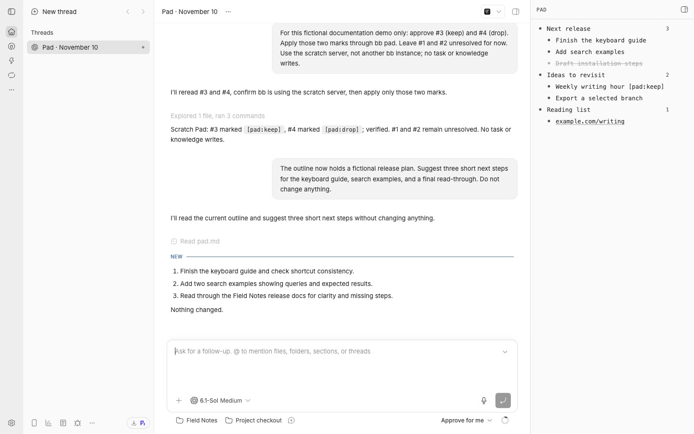
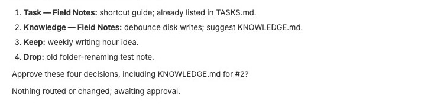
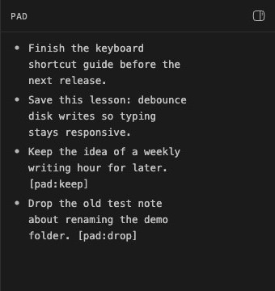

# Pad

A local outline notepad that stays beside your work in bb.



Catch an idea while an agent is working. Keep it in one outline, add a few child notes, and carry on. Pad docks on the right of bb; on a phone, it opens as a full-screen sheet. Your notes live in a Markdown file you can open in any editor, with a local Git history.

When you want to sort the loose ends, turn on daily review. An agent proposes a task, a piece of knowledge, keep, or drop for each pending note. You approve the decisions before anything is routed.

## Install

Install the release from Git:

```sh
bb plugin install git:https://github.com/itsbariscan/bb-pad.git@^0.2.0
```

Once the marketplace listing is accepted, search for **Pad** in bb's plugin marketplace or run:

```sh
bb plugin install pad@bb-community
```

Requires **bb 0.49.0 or later** and **Git** on the machine running the bb server.

## Write, fold, find

Click the Pad row in the sidebar footer to show or hide the panel. Click empty space to write. Click a bullet to zoom into that topic; paste several lines to add several notes.

| Shortcut | Action |
| --- | --- |
| `Enter` | Add a note |
| `Tab` / `Shift+Tab` | Indent / outdent |
| `⌘↑` / `⌘↓` | Move a note with its children |
| `⌘Enter` | Complete or reopen |
| `⌘.` | Fold or unfold |
| `⌘F` | Search notes |
| `⌘⇧Y` | Open Pad and start a note |

On Windows and Linux, use `Ctrl` in place of `⌘`. Rebind the global shortcut in bb's keyboard settings. Outside a note, `Esc` goes up from a zoomed topic.

Capture or read notes from a terminal:

```sh
bb pad add "Check the keyboard shortcut guide"
bb pad today
bb pad show --days 7
bb pad search guide
bb pad path
```

When you ask an agent to save a note, it can use `pad_add`. A note records a thought; it does not authorize an agent to act on it.

## Daily review



Daily review is **off by default**. Choose a bb project for the conversation, then enable it. Pad checks two minutes after startup and every 30 minutes between **07:00 and 23:00**, in the server's local time. It opens or resumes a thread about pending notes before today.

The agent can route approved tasks to a project's tracker and save approved knowledge through that project's documented workflow. It asks where to save knowledge, and leaves the note pending if the project has no documented workflow. Unanswered notes remain pending; delivering a review does not resolve them.

```sh
bb pad review --now --dry-run  # preview the review prompt
bb pad review --now            # start or resume; include today's notes
```

Open review threads are reused. Failed or deferred launches have a 30-minute cooldown and a limit of three attempts per local day.

## Configuration

Open **Settings → Installed plugins → Pad**, or use `bb plugin config pad`.

| Setting | Default | Purpose |
| --- | --- | --- |
| `folder` | `~/Pad` | Holds `pad.md` and its local Git history |
| `review` | `false` | Enables daily review |
| `reviewProject` | Unset | Project where review conversations run |

```sh
bb plugin config pad set folder "~/Pad"
bb plugin config pad set reviewProject <project-id>
bb plugin config pad set review true
bb plugin reload pad
```

Reload after changing settings. The review hours are fixed in this release. Changing `folder` opens the new location; it does not move existing notes.

## Resolution markers



After an approved decision succeeds, the review appends one of these markers:

- `[pad:task:<project>]` — task routed to a project.
- `[pad:knowledge:<project>]` — knowledge saved to a project.
- `[pad:keep]` — keep the note in the outline without asking again.
- `[pad:drop]` — dropped; the note stays in the file and is not asked about again.

Completed notes and marked notes are skipped in later reviews. Remove the marker to reopen a decision. For compatibility, trailing `→ account/project`, `→ kb:project`, and `✕` also count as resolved; avoid those endings on notes you still want reviewed.

## Privacy

Notes and their Git history stay on your bb server. Pad never pushes them. If you connect to a remote bb server, that is where the file lives.

Optional reviews send pending note text to the selected project's agent provider and use its normal quota or billing. Core note capture needs no external account. Pad runs with the same full trust as other bb plugins.

## Development

```sh
npm ci --ignore-scripts
npm test
npm run typecheck
npm run build
```

Git installs build from source with bb's toolchain. Generated `dist/` files are not committed. The screenshots above use a test installation with sample notes.

## License

[MIT](LICENSE). Vendored bb scaffolding retains its [upstream notice](THIRD_PARTY_NOTICES.md).
